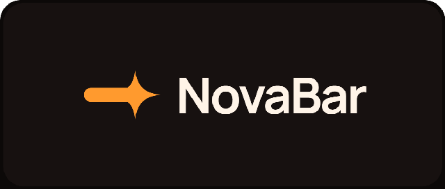

<p align="center">
  
</p>

# NovaBar

A lightweight desktop shell and tiling window manager for **Windows 11**, written in
pure Go. No cgo, no UAC elevation, single binary.

## Requirements

Windows 11 (build 22000 or newer).

This is a deliberate scope decision. Windows 11 guarantees the WebView2 runtime is
present, which means the M4 UI layer needs no bundled `WebView2Loader.dll` and no
fallback path. On startup the daemon logs a clear warning if it detects an older build,
rather than failing mysteriously later.

Go 1.22+ to build. No other dependencies.

## Status

Milestones 1–7 are complete, and so is M12, which is the media work that M5 left half
finished, and M9, which is the multi-monitor correctness work.

Three surfaces are live, all WebView2 hosted inside the shell's own windows and all
talking to the daemon over authenticated, permission-checked JSON-RPC:

| Surface | Kind | Widget |
| --- | --- | --- |
| Bar | AppBar, reserves work area | `widgets/bar` |
| Dock | Overlay, reserves nothing | `widgets/dock` |
| Launcher | Overlay, reserves nothing | `widgets/launcher` |

Verified together on a two-bar layout: both surfaces attach, connect, receive only the
permissions their manifests declare, and subscribe to their topics.

The media area is live too. The shell reads the current session's title, artist, album,
playback state, position and transport capabilities, and drives play, pause, stop, next
and previous. None of that is guessed: the interface identifiers and the vtable slot
order come from the metadata the operating system ships, and a test re-reads that
metadata so the two cannot drift. See
[docs/gsmtc-m5-findings.md](docs/gsmtc-m5-findings.md) for how it was finished and
what it cost.

<p align="center">
  
</p>

## Safety

NovaBar's central promise is that it cannot strand you without a desktop. Four
independent mechanisms enforce it:

| Mechanism | Trigger | Notes |
| --- | --- | --- |
| Watchdog sub-process | Daemon killed, crashed, or power-managed | Waits on the daemon's process handle, restores the taskbars on exit |
| Rescue hotkey | `Ctrl+Alt+Shift+R` (configurable) | Registered during startup, before anything can block |
| `shellctl rescue` | Manual | Talks to the daemon so the AppBar reservation is also released |
| `defer` cleanup | Clean exit | Also runs on rescue and on Ctrl+C |

The watchdog is started **before** any component that can affect the desktop, and
before the first-run modal. There is no window during startup in which a crash leaves
you without a recovery path.

The taskbar is **not** hidden by default (`bar.hide_taskbar = false`). Enabling it is
an explicit opt-in, because it is the one setting the watchdog exists to recover from.

If the daemon is gone and nothing responds:

```powershell
.\bin\shellctl.exe rescue     # works with or without a running daemon
```

## Build

Requires Go 1.22+ on Windows. No other dependencies.

```powershell
.\build.ps1            # build bin/novabar.exe and bin/shellctl.exe
.\build.ps1 test       # build, then run the test suite
.\build.ps1 verify     # build with CGO_ENABLED=0, vet, and test
.\build.ps1 clean
```

`verify` is what CI should run. It asserts the pure-Go constraint rather than trusting
it, because a cgo dependency arriving through a transitive import would only show up on
a user's machine.

## Run

```powershell
.\bin\novabar.exe
```

Config lives at `%APPDATA%\NovaBar\config.toml` and is created with safe defaults on
first run. It is watched live; saving the file re-applies the settings without a
restart. A malformed edit is reported and the previous config stays in force — a typo
can never take the shell down mid-edit.

If the config cannot be parsed at startup, NovaBar runs **inert** (no bars, no tiling)
rather than falling back to a fully featured shell. Unreadable config is not permission
to take over the screen.

### Bars

Any number of bars may be enabled, **at most one per screen edge**:

```toml
[[bars]]
edge = "top"      # top | bottom | left | right
size = 40         # reserved thickness
enabled = true
name = "main"

[[bars]]
edge = "bottom"
size = 6
enabled = true
name = "status"

[[bars]]
edge = "left"
size = 64
enabled = false   # present but off; flip to true to add a dock
name = "dock"
```

`size` is the vertical extent for top and bottom bars, the horizontal extent for left
and right. Adding, enabling, disabling or resizing a bar takes effect on the next save,
with no restart.

One bar per edge is a hard rule, enforced at load. The AppBar API reserves a single
strip per edge, so two bars on the same edge would each shrink the work area from the
same side and leave a gap twice as large as either bar.

`hide_taskbar` is a single global setting under `[general]`, not per bar — it is one
action on one shell object, so asking two bars to do it would be meaningless.

To hide the native taskbar and draw your own, add:

```toml
[general]
hide_taskbar = true
```

That is the one setting the watchdog exists to recover from.

## CLI

```
shellctl --rescue          restore the taskbar and shut the shell down
shellctl --shutdown        the same, without the emergency framing
shellctl --status          show shell status
shellctl --status --json   machine-readable status
```

`--rescue` asks the running daemon to clean up, because that is the only path that also
releases the reserved AppBar work area and stops the daemon re-hiding the taskbar. With
no daemon reachable it falls back to un-hiding the taskbars directly.

## Architecture

```
cmd/daemon        daemon entrypoint, subsystem wiring, event pump, RPC methods
cmd/shellctl      control CLI
internal/win      Win32 bindings; every callback thunk is hoisted to a package var
internal/tracker  window enumeration and filtering, stable ordering
internal/tiling   pure layout functions, rule evaluator, DWM frame correction
internal/bar      multi-bar AppBar manager: registration, work-area reservation
internal/workspace virtual workspaces over window visibility
internal/config   TOML schema, validation, live-reload watcher
internal/rpc      token-authenticated JSON-RPC over loopback WebSocket + control endpoint
internal/launcher Start Menu + PATH indexing, ranked search, validated launch
internal/hotkey   global hotkey registration
internal/watchdog detached recovery process
internal/webview  WebView2 surfaces hosted in the shell's own windows
internal/overlay  transient surfaces that reserve no work area (the launcher)
internal/media    GSMTC bridge: session reads, playback state, transport control
internal/winrt    the slice of the COM and WinRT ABI the media bridge needs
internal/winmd    reads Windows Runtime metadata, for identifiers and slot order
internal/volume   per-application audio volume via Core Audio (WASAPI)
```

### Widgets

A widget is a directory under `widgets/` with an `index.html` and an optional
`manifest.json`. There is no build step and no bundler: the daemon serves the directory
over loopback and a surface navigates to it.

```toml
[[bars]]
edge = 'top'
size = 40
enabled = true
name = 'main'
widget = 'bar'          # directory under the widgets root
transparent = true      # composite over the desktop
```

The widget root is found next to the executable, then under the working directory, or
set explicitly with `NOVABAR_WIDGETS` when running from a checkout.

The RPC endpoint and session token are **injected** into the page by the daemon before
it loads, as `window.NOVABAR`. They are not written into any file, so a widget on disk
contains no credentials. `sdk/novabar.js` is served from `/sdk` and imported directly.

Widget assets are served without the session token: they are static presentation with
no secrets in them, and the token arrives at runtime instead.

### Widget permissions

A widget's `manifest.json` declares what it needs, and the daemon enforces it on every
call and every subscription:

```json
{ "permissions": ["windows.read", "windows.focus", "audio.control"] }
```

Available: `windows.read`, `windows.control`, `workspaces.manage`, `launcher.use`,
`media.control`, `config.read`.

Enforcement uses a **per-surface credential**, distinct from the session token. The
session token proves a page belongs to this shell; the credential proves which surface
it is and therefore what that surface's manifest was granted. The session token alone
calls nothing.

An unknown permission in a manifest is rejected and the widget is denied everything,
rather than the entry being silently ignored. A method with no permission mapping is not
callable by widgets at all, so adding one later is inaccessible until someone decides
what it should require.

### Layout geometry

Bar rectangles are computed by the shell, not taken from the system's work area, and
adjacent edges are inset so they never overlap. A horizontal bar keeps the full width and
owns the corner; a vertical bar starts below or beside it. Insetting both, which was the
first attempt, left a dead square belonging to neither bar.

Surfaces track their bar's real rectangle, not its thickness. A left dock is narrow and
full height; sizing it to thickness-squared renders a small square in the top-left
corner, on top of the top bar, which reads as a missing dock rather than as a bug.

### IPC

The RPC server binds an **ephemeral** loopback port and generates a 256-bit session
token, both published to `%APPDATA%\NovaBar\ipc.json` with a user-only ACL. Connections
without the token are refused and pub/sub is opt-in per topic. This matters: an
unauthenticated loopback control surface is reachable from any web page the user
visits.

```jsonc
// widgets connect like this
const sdk = new NovaBarSDK(await fetchConfig());
sdk.connect();
await sdk.call("windows.get");
sdk.subscribe("windows.updated", onWindows);
```

## Roadmap

The board is the source of truth: [NovaBar Roadmap on Notion](https://basalt-lancer-b02.notion.site/0a5506f72fd540acaa0a0123c9c29d80?v=3ffd677f1c2f817bb34f000ced4524cd).
The table below is generated from it by a scheduled GitHub Action, so the two cannot
drift. **Labels** are the cross-cutting themes, the ones that appear on more than one
milestone, so a question like which milestones touch the widget platform is one filter
away on the board.

<!-- ROADMAP:BEGIN -->
| Milestone | State | Labels |
| --- | --- | --- |
| Bug — Icons have a black border and are low quality | Done | `core`, `ui` |
|  | — | — |
| M1 — Win32 core, safety foundations | Done | `core`, `win32`, `safety` |
| M2 — Pure-function tiling engine | Done | `core`, `tiling` |
| M3 — AppBar, workspaces, taskbar management | Done | `win32`, `shell` |
| M4 — WebView2 UI, widget platform | Done | `ui`, `widgets` |
| M5 — App launcher, GSMTC media | Done | `shell`, `ui`, `win32` |
| M6 — Settings menu | Done | `ui`, `widgets`, `safety` |
| M7 — Per-app volume | Done | `audio`, `win32` |
| M8 — Keyboard window management | In Progress | `core`, `power-user`, `ui` |
| M9 — Multi-monitor correctness | In Progress | `win32`, `multi-monitor` |
| M10 — HiDPI and per-monitor scaling | Planned | `multi-monitor`, `accessibility`, `ui` |
| M11 — Accessibility | Planned | `accessibility`, `ui` |
| M12 — GSMTC media reads | Done | `media`, `winrt`, `win32` |
| M13 — App menu: grid, jump lists, recent files | Planned | `shell`, `ui` |
| M14 — Global file search | Planned | `search`, `ui` |
| M15 — Command palette | Planned | `power-user`, `ui` |
| M16 — Window previews and groups | Planned | `ui`, `shell` |
| M17 — Layout presets | Planned | `tiling`, `ui` |
| M18 — Per-app window memory | Planned | `persistence`, `ui` |
| M19 — Notifications | Next | `shell`, `notifications`, `DynamicIsland` |
| M20 — Clipboard manager | Planned | `clipboard`, `power-user` |
| M21 — System mixer panel | Next | `audio`, `ui`, `DynamicIsland` |
| M22 — Screenshot tool | Planned | `power-user`, `ui` |
| M23 — Persistence and theming | Planned | `persistence`, `ui` |
| M24 — Plugin API for widgets | Planned | `widgets`, `plugin` |
| M25 — Files app | Planned | `explorer`, `files` |
| M26 - Dynamic Island | Partial | `ui`, `widgets`, `power-user`, `media`, `plugin`, `DynamicIsland` |
| M27 — Full shell replacement | Option | `explorer`, `windows-shell` |
| M28 — Spotify Integration | Partial | `audio`, `widgets`, `media` |
| M29 — Installer | Planned | `core`, `ui`, `safety` |
<!-- ROADMAP:END -->

The notes that follow explain the milestones where the reasoning is not obvious from the
title.
### M8 — Keyboard window management

**The tiling engine works, and there is no way to drive it.** The only hotkeys are
rescue, launcher, settings and the two workspace steps. You cannot focus a window in a
direction, move one, resize one, or move one to another workspace.

Planned, all from a configurable keymap:

| Keys | Action |
| --- | --- |
| `Win+H` `J` `K` `L` | Focus the window to the left, down, up, right |
| `Win+Shift+H` `J` `K` `L` | Move the focused window |
| `Win+Ctrl+H` `J` `K` `L` | Resize the focused window |
| `Win+1`…`Win+9` | Jump to a workspace |
| `Win+Shift+1`…`9` | Move the focused window to a workspace |

Focus and move are the same operation in most tiling window managers, distinguished only
by intent, so they are worth doing together.

### M9 - Multi-monitor correctness

**Shipped.** Bar geometry came from `GetSystemMetrics`, which reports the **primary
display only**, rather than `MONITORINFO` per monitor. A window dragged to a second
screen landed in the wrong place, and per-monitor work areas were not honoured.

What changed:

| Piece | How |
| --- | --- |
| Bar geometry | The bars are placed against a rectangle that can be the whole desktop or the primary display, chosen by `general.bar_scope`. The default is the primary display, because the shell reserves the work-area strip only for the display the bar's rectangle starts on: a bar drawn across the desktop is drawn over the second display too, but the windows there are not moved out of its way. |
| Floating windows | Floated on the display they are on. They used to be moved back to the primary, which put a window the user had dragged to their second screen somewhere they had not put it and could not see it. |
| Overlays | The launcher, the settings and the dock are placed against the primary display's rectangle rather than the virtual origin. The primary is not always at the origin of the virtual screen: a display to the left of it puts the origin somewhere else, and an overlay centred against that lands on the wrong display. |
| Work area | Reads and writes use the primary display's rectangle, which is the display the work area belongs to. |

One thing did not work the way it looked like it would: the virtual screen metrics
were being read from the wrong pair of constants, which made the desktop two pixels
wide and put every bar in the corner. There is a test now that checks the virtual
screen contains the primary display, because a constant read from the wrong pair fails
silently.

### M10 - HiDPI and per-monitor scaling

Per-monitor DPI awareness, so a bar and dock on a mixed-DPI setup are crisp rather than
blurry. The WebView2 surfaces are not DPI-aware everywhere today.

Early rather than late, because every surface added afterwards inherits whatever
scaling behaviour exists at the time. Retrofitting it means re-testing every widget.

### M11 — Accessibility

Screen reader support for the widgets, high contrast, and full keyboard navigation. A
shell that owns the taskbar owns accessibility too, and Windows will not read our bar for
us.

Also early for the same reason as M10: an interface built without accessibility in mind
is an interface that has to be rebuilt.

### M12 — GSMTC media reads

**Shipped.** This finishes M5. Activation worked; reading a session did not. The
obstacle was one identifier — the IID of the statics interface — and it turned out to
be sitting in the metadata the operating system ships with, in a place nobody had
looked: not in the GUID heap, which holds one entry, but in a `GuidAttribute` on each
interface.

`docs/gsmtc-m5-findings.md` has the whole story, including the parts that are now
wrong. The identifiers and the vtable order are no longer written down from
documentation at all: `internal/winmd` reads the metadata, and a test fails if the
constants and the metadata ever disagree.

### M13 — App menu: grid, jump lists, recent files

The launcher already searches applications and windows, but it presents as a search box.
This makes it a menu: a grid of all applications, recent files, and per-application jump
lists.

The Windows key opens it. The bare Windows key is bindable — measured on Windows 11,
`RegisterHotKey` for `Win` alone succeeds while `Ctrl+Esc` and `Win+Space` are both
already taken.

### M14 — Global file search

Index files as well as applications, so the app menu can find a document and open it with
its default handler.

### M15 — Command palette

Type a few letters and run any command, switch workspace, or open anything. Faster than
the app menu for someone who already knows what they want, and the natural home for
commands contributed by third-party widgets (M24).

### M16 — Window previews and groups

Hovering a window in the bar shows a live thumbnail, and clicking a group restores that
stack — the thing Windows 11's taskbar does well, and a tiling shell can do better
because it knows the grouping.

### M17 — Layout presets

Named layouts the user can apply to the current workspace: split, stack, tabbed, monocle,
float. The engine can already produce these; what is missing is a way to pick one.

### M18 — Per-app window memory

Each application reopens where you last left it, and each workspace keeps its own layout.
Part of M23, but the per-application part is a distinct idea.

### M19 — Notifications

Own the notification area: toast history, per-application grouping, do-not-disturb. A
shell that owns the taskbar and the dock but not the notifications still has the Windows
shell showing through.

### M20 — Clipboard manager

A searchable clipboard history. Small, self-contained, and one of the few features people
notice every day.

### M21 — System mixer panel

Master volume, per-application volume and input/output device selection. M7 gives
per-application volume; this makes it visible and adds device switching.

### M22 — Screenshot tool

A screenshot tool bound to a key, saving straight to a folder. Small, and it belongs to a
desktop shell.

### M23 — Persistence and theming

Restore windows, their workspace and the layout after a reboot, plus light and dark
themes and an accent colour. Makes the shell feel like a machine you own rather than one
you reconfigure.

### M24 — Plugin API for widgets

Let third-party widgets add commands, panels and keybindings. The M4 widget platform
already isolates everything behind manifest permissions, so this is mostly a matter of
exposing more surface. Commands land in the command palette (M15).

### M25 — Files app

A file manager. It comes **before** replacing Explorer, because it is useful on its own
and does not require taking over the shell to be worth having.

### M26 - Dynamic Island

**The shell needs somewhere to say things that are not the desktop.** A media track
playing, a notification arriving, a plugin's command waiting, the window you are
looking for — these are all short-lived, all want to be visible without taking the
screen, and all end up as a separate overlay today.

The island is the macOS answer: a small pill at the top that expands when there is
something to say and folds away when there is not. NovaBar already has half of it —
the media pill in the bar is exactly the island, collapsed — so this is a matter of
making it a surface of its own and letting more than media live in it.

Two things make it a milestone rather than a widget. It has to be **the** place
transient things appear, so the launcher, the notifications from M19 and the
plugin's commands from M24 all land in the same place instead of each inventing
one. And it has to be **interruptible**: an island that cannot be pushed aside
becomes another taskbar, and the shell already has one of those.

The groundwork is done, which is the argument for doing it now rather than later:
the widget platform exists with permissions (M4), the media read path exists (M5,
M12), and the shell can be told what the focused window is. What is missing is the
surface itself, and the rule about what may interrupt what.

### M27 - Full shell replacement

**An option, not a requirement.** Replacing Explorer means desktop icons, context menus
and the recycle bin on top of the file manager from M25. It is the most ambitious item
here and the only one that means truly owning the desktop: a long tail of shell internals,
and weeks of work.

Everything above it is worth doing whether or not this ever happens.

## Media sessions (M5, M12)

Shipped. The bar shows the session that is playing: title, artist, playback state and
the transport buttons. The daemon re-reads it every couple of seconds and broadcasts
the change, so the bar follows what is playing without the widget polling.

What it does, and how:

| Piece | How it was done |
| --- | --- |
| Identifiers | Read from `C:\Windows\System32\WinMetadata\Windows.Media.winmd`, the metadata the operating system ships. `internal/winmd` parses it: the PE container, the heaps, and the tables. |
| Slot order | Read from the same metadata. The ABI puts an interface's first method at slot 6, and the metadata says which method that is. |
| No guesses | A test re-reads the metadata and fails if an identifier or a slot drifts from it. The wrong class name in this area cost a day; a wrong identifier would have cost the same. |
| One thread | WinRT initialises per thread, and the daemon answers media over RPC on whichever goroutine the request arrived on. The bridge owns a thread, and every call into the runtime happens on it. |
| Polling, not events | The stack publishes change events, but a callback crossing a thread boundary is where the crashes in this area came from. Polling cannot fault. |
| Honest about silence | No session is a normal state, not an error. The shell says so rather than showing an empty player. |

The media properties turned out to be simpler than expected: the session hands back a
media properties object with the title, artist and album on it, so there is no property
bag to marshal after all.

## Settings menu (M6)

Shipped. Opens with `Ctrl+Alt+S`, an in-shell overlay with the same shape as the
launcher: a plain topmost window, no work-area reservation, dismissed with the same
sentinel.

What it does, and how:

| Piece | How it was done |
| --- | --- |
| Schema introspection | `internal/config.Schema` declares every editable setting with a getter and a setter. The UI is **generated** from it, so a control cannot exist that the daemon would refuse, and a field cannot be added without appearing. |
| Typed editing | `config.set` applies one field and revalidates the whole document, so a bad edit is refused with a reason rather than persisted and failing at the next launch. |
| First toggles | Bar enable and size for all four edges, tiling enabled, layout and gaps, the dock, every hotkey, log level, and the taskbar. |
| Hotkey capture | The one thing a text field cannot do. The daemon checks the chord with the same parser `Register` uses, so the page cannot accept a combination that then silently fails to bind. |
| Apply without restart | Changes take effect immediately. The one gap: layout and gap changes do not re-tile windows that are already open. |
| Safety | `hide_taskbar` and the rescue hotkey are marked `SafetyProtect`. The daemon refuses them while the rescue path is not working, because those are the settings that get the user out. |

Not planned: a settings daemon, a background service, or any config persisted outside
`%APPDATA%\NovaBar\config.toml`.

**Rules are deliberately not editable here.** They are a list of records with compound
matching and do not fit a generated form, so editing them stays a `config.toml` job.
