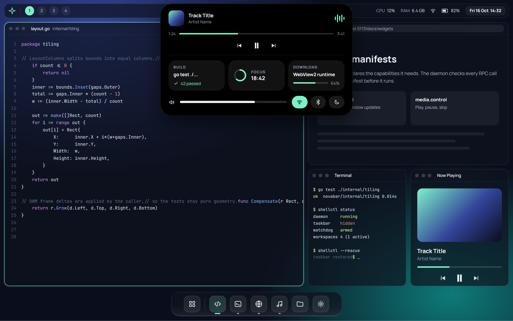

# NovaBar

  

A lightweight desktop shell and tiling window manager for **Windows 11**, written in
pure Go. No cgo, no UAC elevation, single binary.

## What it is

NovaBar replaces the parts of the Windows shell you actually look at — the taskbar,
the app launcher, the window tiling — with components you control. It runs as a
single daemon, hosts its UI in WebView2 surfaces, and talks to them over an
authenticated, permission-checked JSON-RPC channel.

Three surfaces are live today:

| Surface | Kind | Widget |
| --- | --- | --- |
| Bar | AppBar, reserves work area | `widgets/bar` |
| Dock | Overlay, reserves nothing | `widgets/dock` |
| Launcher | Overlay, reserves nothing | `widgets/launcher` |

## Highlights

- **Pure Go.** `CGO_ENABLED=0`. No C compiler required to build.
- **Safe by construction.** A watchdog sub-process, a rescue hotkey, and a `shellctl rescue`
  command mean a bad configuration can never strand you without a desktop.
- **Live config.** Edit `%APPDATA%\NovaBar\config.toml` and changes apply without a restart.
- **Widget platform.** Drop an `index.html` + `manifest.json` into `widgets/` and it is served
  over loopback with per-surface permissions.
- **Media + Spotify.** The bar shows the playing track (GSMTC or Spotify Web API) with
  transport controls.

## Screenshots

The screenshot above shows a two-bar layout with the top bar's Dynamic Island pill in the
centre: clock and date always visible, media track info when something is playing.

## Quick links

- [Getting Started](getting-started.md)
- [Configuration](configuration.md)
- [Widgets](widgets.md)
- [Safety model](safety.md)
- [Architecture](architecture.md)

## Status

Milestones 1–7, 9, 12, 26 and 28 are shipped. See the [roadmap](https://github.com/ngbcoder/NovaBar#roadmap)
in the README for the full board.